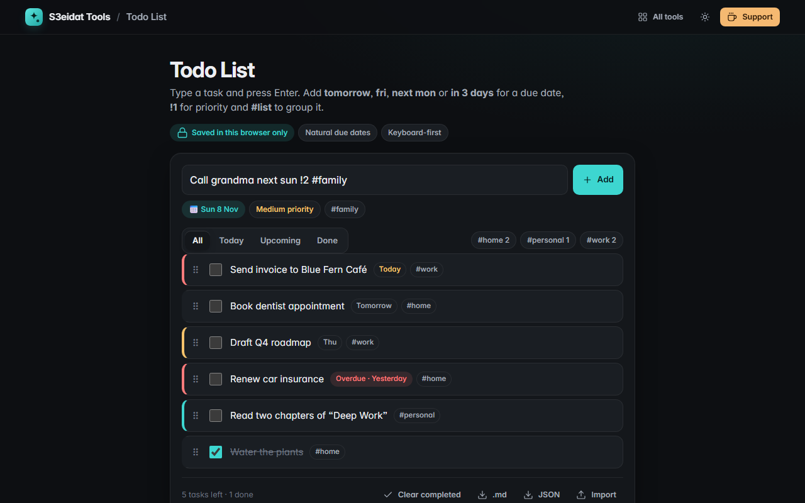

# Todo List

> A fast, keyboard-friendly to-do list. Free, private, and it runs entirely in your browser.

### ▶ [Open Todo List](https://s3eidat.github.io/todo-list/)



## Features

- **Add with Enter**; a live preview shows what was understood before you add
- **Natural due dates**: `today`, `tomorrow`, `fri`, `next mon`, `next week`, `in 3 days`, `in 2 weeks`, `5 nov`, `jan 3rd`, `2026-12-01`, and Arabic `اليوم` / `بكرا` / `غداً`
- **Priorities**: `!1` `!2` `!3` (or `p1`, `!high`, `!!!`)
- **Lists**: `#work`, `#home` … click a list chip to filter; new tasks join the list you're viewing
- **Filters**: All, Today (due today or overdue), Upcoming, Done
- **Drag to reorder** with the ⠿ handle (mouse, pen or touch)
- Double-click to edit (you can type new due words while editing), delete with undo, **clear completed with undo**
- Keyboard: <kbd>/</kbd> focuses the input, <kbd>↑</kbd>/<kbd>↓</kbd> moves between tasks, <kbd>Space</kbd> ticks, <kbd>Delete</kbd> removes
- **Export** as a Markdown checklist or a JSON backup; **import** a JSON backup (validated)

## Privacy

Your tasks never leave your device. They are stored in your browser's localStorage, with no server, no account
and no analytics. The page ships with a strict Content-Security-Policy (`connect-src 'self'`), so the browser
itself blocks any attempt to send data anywhere.

## Run it yourself

It's plain HTML, CSS and JavaScript with no build step:

```bash
git clone https://github.com/s3eidat/todo-list
cd todo-list
python -m http.server 8000
```

Then open http://localhost:8000.

## Support

If this saved you time, **[buy me a coffee ☕](https://s3eidat.github.io/coffee/)**. It keeps every tool free.

---

Part of **[S3eidat Tools](https://s3eidat.github.io/)**: 100+ free, private tools that run in your browser. MIT licensed.
